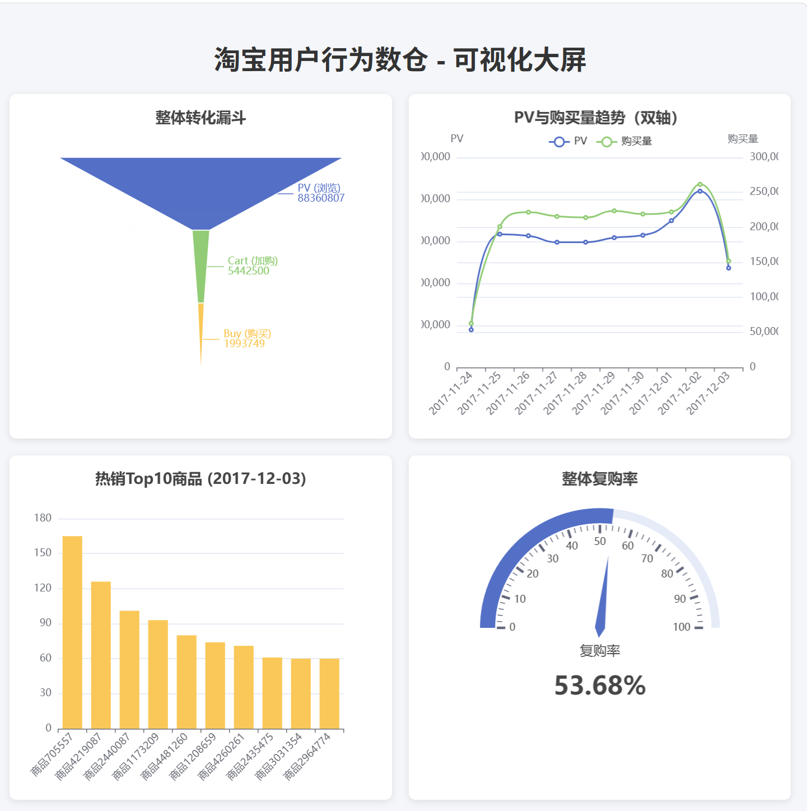
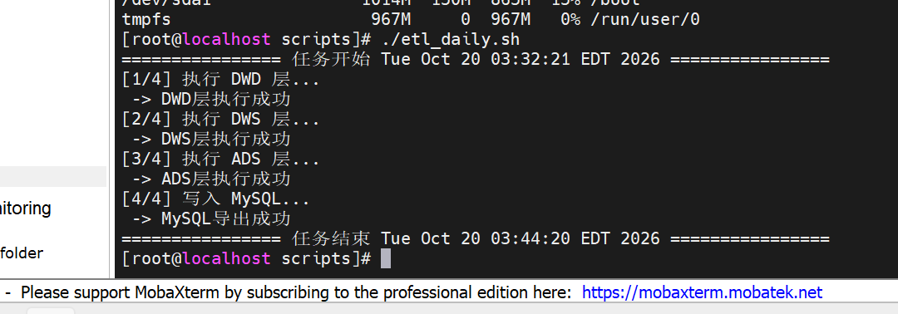

# 基于 Hive + Spark 的电商用户行为离线数仓

## 项目简介

本项目基于公开的淘宝电商用户行为数据集（约 1 亿条），使用 Hadoop HDFS 作为底层存储，Hive + SparkSQL 完成 ODS → DWD → DWS → ADS 四层数仓建模。项目清洗了异常时间戳脏数据，针对商品维度的长尾倾斜采用“DWS 预聚合 + 两阶段加盐聚合”优化，最终将 PV、UV、转化率、复购率、TopN 商品等核心指标通过 Spark JDBC 导出至 MySQL，并由 Flask + ECharts 完成数据大屏可视化，基于 Shell + Crontab 实现全流程自动化跑批。

## 技术栈

- **底层存储**：HDFS（Hadoop 3.x；阶段一为 HA 集群，阶段二为单机伪分布式）
- **计算引擎**：Spark 3.x（SparkSQL）、Hive Metastore
- **数据仓库**：Hive（ODS / DWD / DWS / ADS 四层建模）
- **结果存储**：MySQL 5.7
- **工程调度**：Shell + Crontab（`etl_daily.sh` 一键跑批）
- **可视化**：Flask + ECharts

## 架构演进说明

本项目分两阶段完成，环境从集群模式降级为单机伪分布式。

### 阶段一：集群模式（数据探查）

- 环境：Zookeeper + HDFS HA（node01 / node02 / node03/node04/node05）+ YARN + Hive
- 用途：完成原始数据上传、Spark Shell 探查、数据质量问题排查
- 成果：《数据探查报告》全部结论（字段分布、异常时间戳占比、行为分布等）

### 阶段二：单机伪分布式（数仓建模）

- 环境：单节点虚拟机（物理内存 10G，2 核 CPU；Spark driver 1G，Spark 可用堆内存约 2G），`local[2]` 模式
- **降级原因**：
  1. YARN 的 ResourceManager / NodeManager 在单机伪分布式下额外占用资源，container 分配带来调度开销，Spark on YARN 卡在 7.5% 无法推进；
  2. DWD 层 Shuffle 时本地磁盘被临时文件撑爆，DataNode 报 `No space left on device`；
  3. 综合判断后关闭 YARN，改用 `spark-sql --master local[2]`，把资源直接交给 Spark 调度。
- **优化手段**：
  - shuffle 分区从 200 调到 8；
  - 启用 AQE 自适应执行；
  - DWS 层做预聚合；
  - 放弃全量 `ROW_NUMBER()` Shuffle 去重，改为分区内过滤 + 派生策略去重；
  - 脚本内置 `/tmp/spark-*` 与 HDFS `.spark-staging` 清理逻辑。
- 成果：ODS → DWD → DWS → ADS → MySQL 全链路跑通，总耗时约 12 分钟。

## 数仓分层架构

1. **ODS 层**：原始数据层，直接映射 CSV 数据，保留原始格式（TEXTFILE）。
2. **DWD 层**：明细数据层，过滤异常时间戳（约 1.5%）、去重、类型转换、派生 `dt` / `hour`，按天分区（PARQUET）。
3. **DWS 层**：汇总数据层，按天、商品、用户维度轻度聚合，含两阶段加盐解决倾斜。
4. **ADS 层**：应用数据层，输出漏斗指标、TopN 商品、复购率等业务指标。
5. **数据导出**：Spark JDBC 写入 MySQL。
6. **可视化**：Flask 提供 API，ECharts 渲染大屏。

## 核心指标口径

| 指标 | 口径定义 |
|---|---|
| PV | 页面浏览量 |
| UV | 独立访客数（去重后的 `user_id`） |
| 加购转化率 | `cart / pv` |
| 购买转化率 | `buy / pv` |
| 复购率 | 统计周期内，`COUNT(DISTINCT dt) >= 2` 的用户占比 |
| TopN | 每日购买量排名前 10 的商品 |

> 注：原始数据无价格字段，GMV 以购买量替代。

**复购率口径纠偏**：数据集缺失订单号，若按“购买次数 >= 2”计算，同一天多次点击会被误算为复购，得到 64.98% 的异常值；纠正为 `COUNT(DISTINCT dt) >= 2`（按购买天数去重）后，复购率回归至合理的 **53.68%**。

## 核心业务指标成果

1. **转化漏斗**：全站 PV 约 8836 万，整体加购转化率约 6.1%，购买转化率约 2.2%。
2. **大盘趋势**：完成 11-24 至 12-03 的 PV 与购买量双轴趋势分析。
3. **热销 TopN**：每日计算购买量最高的 Top 10 商品，捕捉双十二大促前夕的爆款。
4. **复购率**：按购买天数去重口径，整体复购率 **53.68%**（剔除边界脏数据）。
5. **数据规模**：原始数据约 1 亿条，清洗后有效明细约 9863 万条。

## 项目难点与优化

1. **数据清洗与时间戳陷阱**：原始数据约 1.5% 的异常时间戳（负数、超大值）导致日期出现 1902 / 2037 年。CSV 默认读成 String，`min/max` 走字典序会得到 1929 / 2001 等错误年份；在 DWD 层通过限定时间窗口 `1511544070 ~ 1512312365` 强转过滤，并显式 `CAST(AS BIGINT)`，最终准确清洗出 9863 万条有效明细。
2. **磁盘爆满**：DWD 层 Shuffle 写本地临时文件，导致 `/dev/mapper/centos-root` 剩余空间仅 1.1G，DataNode 报 `No space left on device`；后期又出现 `minReplication nodes` 错误。排查后清理 `/tmp/spark-*` 和 HDFS staging 目录，并在调度脚本中内置清理逻辑、跳过已生成分区。
3. **YARN 调度瓶颈**：单机伪分布式下 YARN 的 container 分配开销大，Spark 任务卡在 7.5%。改用 local 模式后资源利用率显著提升。
4. **Shuffle 分区过多**：Spark 默认 200 个 shuffle 分区，在单机 2 核环境下严重浪费，调小为 8 并开启 AQE 自适应执行解决。
5. **单节点低内存防爆**：在资源受限的单节点上，放弃 `ROW_NUMBER()` 全量 Shuffle 去重，改用无 Shuffle 过滤 + 派生策略，避免磁盘被溢写撑爆。
6. **商品维度数据倾斜**：商品访问呈极度长尾效应（Top1 商品出现 32633 次，均值 24 次），TopN 计算时通过 DWS 预聚合缓解倾斜；进一步采用“两阶段加盐聚合”（子查询用 `RAND()` 盐值打散后局部聚合，再去盐全局聚合），配合 Spark AQE，解决倾斜导致的卡死问题。
7. **指标口径纠偏**：复购率由“购买次数 >= 2”纠正为 `COUNT(DISTINCT dt) >= 2`，使 64.98% 的异常值回归至 53.68%。
8. **工程化调度与排错**：封装 `etl_daily.sh` 实现一键自动化调度，各层日志落盘，支持失败重跑与分区跳过。

## 可视化效果



- 漏斗图：整体转化漏斗（PV → Cart → Buy）
- 折线图：PV 与购买量趋势（双轴）
- 柱状图：热销 Top10 商品
- 仪表盘：整体复购率（53.68%）



## 项目目录结构

```text
ecommerce-warehouse/
├── docs/                         # 项目文档（探查报告、设计、口径、日志）
├── sql/                          # 核心 SQL（按层分离）
│   ├── dwd.sql
│   ├── dws.sql                   # 含两阶段加盐解决倾斜
│   ├── ads.sql
│   └── to_mysql.sql
├── scripts/                      # 自动化调度
│   ├── etl_daily.sh              # 一键跑批脚本
│   └── logs/                     # 各层运行日志记录
├── web/                          # 可视化服务
│   ├── app.py                    # Flask 后端 API
│   └── templates/index.html      # ECharts 大屏前端
└── images/                       # 项目截图