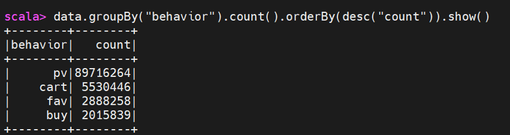
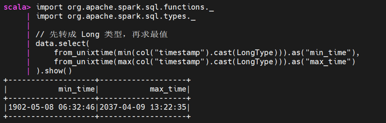
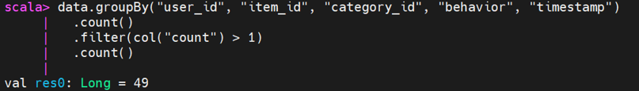
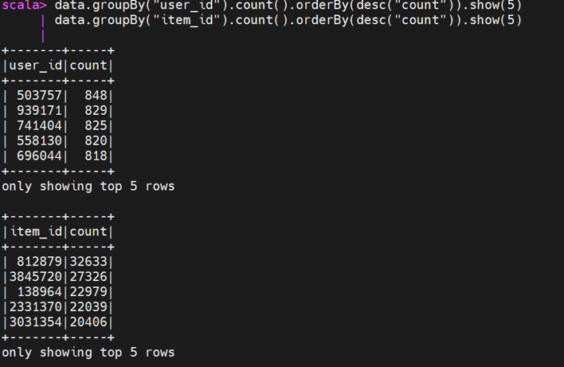

# 淘宝用户行为数据探查报告

## 一、探查概述

- **数据源**：阿里天池淘宝用户行为数据集（UserBehavior.csv）
- **数据规模**：100,150,807 条记录（约 3.4 GB）
- **探查工具**：Hadoop 3.3.6 + Spark 3.5.8（阶段一 YARN 模式）
- **探查时间**：2026-09-27
- **探查目的**：了解数据质量、真实时间范围、业务分布及潜在倾斜，为 ODS / DWD 层建模和清洗提供依据。
- **字段结构**：`user_id`（用户 ID）、`item_id`（商品 ID）、`category_id`（类目 ID）、`behavior`（行为类型）、`timestamp`（时间戳）

## 二、数据结构与基础统计

- 原始 CSV 无表头，默认列为 `_c0 ~ _c4`，重命名为 `user_id, item_id, category_id, behavior, timestamp`（全为 String 类型）。
- 空值：0 条。
- 唯一值：用户数 987,994；商品数 4,162,024；类目数 9,439。

## 三、业务分布洞察

- 行为类型仅有 pv、cart、fav、buy 四类，分布为：
  - pv：89,716,264 条（89.7%）
  - cart：5,530,446 条（5.5%）
  - fav：2,888,258 条（2.9%）
  - buy：2,015,839 条（2.0%）
- 业务结论：符合电商漏斗模型，整体购买转化率（buy / pv）约 2.2%。
- 数据时间段集中在 2017-11-25 至 2017-12-03，正值双十二大促前夕。

## 四、数据质量问题（核心发现）

### 1. 时间戳类型陷阱

CSV 读取时 Spark 默认将 `timestamp` 识别为 String 类型，直接使用 `min/max` 会按字典序排序，得出 1929、2001 等错误年份。需显式 `CAST(AS BIGINT)` 后再做时间转换与比较。

### 2. 异常时间戳（脏数据）

原始数据中存在负数时间戳（如 `-1586903608`）和超大正数时间戳（如 `2122867355`），转换后会得到 1902 年、2037 年等荒谬日期。异常占比 **1.509%**（约 151 万条），推测为上游日志采集或埋点系统的错误占位符。

### 3. 完全重复行

发现 49 条完全重复行。由于占比极低（约千万分之一），且单节点环境下全量去重（row_number 或 dropDuplicates）会引发严重 Shuffle 导致磁盘爆满，故在 DWD 层按业务容忍度直接忽略，后续按天/按用户聚合时自然消解

### 4. 数据倾斜风险

- **用户维度**：人均行为约 101 次，最高 848 次（用户 503757）。
- **商品维度**：件均行为约 24 次，最高 32,633 次（商品 812879），呈现极端的爆款长尾效应。这预示着后续按商品聚合（计算 TopN）时，必然会发生严重的数据倾斜。

## 五、清洗策略与建议（给 DWD 层）

1. **过滤**：`timestamp` 限制在 `1511544070 ~ 1512312365` 之间（对应 2017-11-25 至 2017-12-03），剔除约 1.5% 的异常脏数据。
2. **去重**：使用 `dropDuplicates()` 处理 49 条完全重复数据。
3. **类型转换**：ID 字段 String → BigInt，`timestamp` String → Long，避免类型溢出与字典序比较陷阱。
4. **时间派生**：利用 `from_unixtime` 提取 `dt`（日期）、`hour`（小时）字段，用于后续分区和聚合。