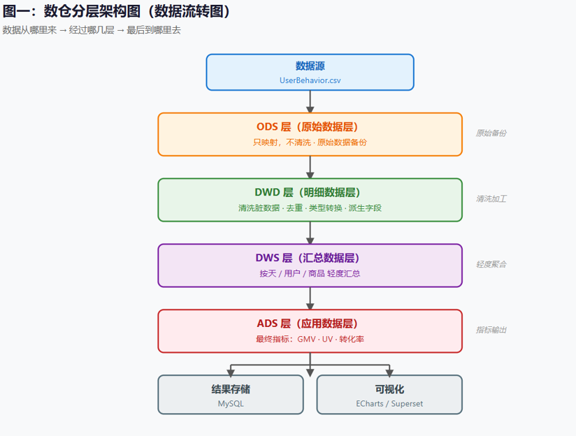

# 数仓设计文档

## 一、整体分层架构

本项目采用经典的离线数仓四层架构，数据流向为：`ODS → DWD → DWS → ADS`，最终导出至 MySQL 供可视化调用。

**核心设计理念**：分层的本质是解耦。ODS 保证可回溯，DWD 保证一致性，DWS 保证性能，ADS 保证口径统一。

1. **ODS（原始数据层）**：原封不动地映射 HDFS 上的原始 CSV 文件，不做任何清洗与转换，保留数据原貌（TEXTFILE 格式），用于数据追溯。
2. **DWD（明细数据层）**：完成数据清洗（过滤异常时间戳、重复行）、类型转换（String 转 BigInt）、派生时间维度字段（`dt`、`hour`），使用 Parquet 列式存储，按天分区。
3. **DWS（汇总数据层）**：按分析维度进行轻度聚合。**将千万级明细数据压缩至万级**，避免 ADS 层重复扫全表。分为按天、按商品、按用户三个维度。
4. **ADS（应用数据层）**：面向最终业务指标，输出转化漏斗、TopN 商品、复购率等结果，直接对接 MySQL。

## 二、存储与分区策略

- **存储格式**：ODS 层采用 `TEXTFILE`；DWD、DWS、ADS 层均采用 **`PARQUET`** 列式存储（压缩率高，查询速度快，支持谓词下推）。
- **分区策略**：DWD、DWS 表按 `dt`（日期）进行动态分区。**按天分区，每个分区约 1000 万条**。查询时通过 `WHERE dt = 'xxx'` 直接定位分区，避免全表扫描。
- **分区分桶（优化）**：在单节点环境下未开启分桶，通过调小 `spark.sql.shuffle.partitions` 并开启 AQE（自适应查询执行）来控制小文件数量。

*(插入截图：07_hdfs_dir.png，展示 HDFS 上的数仓层级目录)*

## 三、核心表结构与清洗规则

### 1. ODS 层：原始数据表 `ods_user_behavior`
- **表类型**：`EXTERNAL TABLE`（删表不删数据，HDFS 上的 CSV 仍然保留）
- **存储格式**：`TEXTFILE`
- **字段设计**：所有字段（`user_id`, `item_id`, `category_id`, `behavior`, `timestamp`）均保持 `STRING` 类型，**不做类型转换**，保留原始格式。需注意 `timestamp` 是 Hive 保留字，建表时需用反引号。

### 2. DWD 层：明细数据表 `dwd_user_behavior`
- **表类型**：`MANAGED TABLE`，按天分区（`dt`）
- **核心清洗规则**：
  1. **异常过滤**：过滤 `ts < 1511544070` 或 `ts > 1512312365` 的异常记录（约 1.5%）。
  2. **重复行处理**：完全重复行约 49 条（占比极低）。由于全量去重（ROW_NUMBER）会引发海量 Shuffle 导致单节点卡死，故采取‘业务容忍’策略直接忽略，后续在做按天/按用户聚合时，这 49 条重复数据会被自然折叠（汇总），不影响大盘指标。
  3. **类型转换**：ID 字段由 String 转换为 `BIGINT`，`timestamp` 转换为秒级 `BIGINT`。
  4. **派生字段**：`dt = to_date(from_unixtime(ts))`，`hour = date_format(...)`。

| 字段名 | 类型 | 含义 | 说明 |
| :--- | :--- | :--- | :--- |
| user_id | BIGINT | 用户ID | 类型转换 |
| item_id | BIGINT | 商品ID | 类型转换 |
| category_id | BIGINT | 类目ID | 类型转换 |
| behavior | STRING | 行为类型 | pv/cart/fav/buy |
| ts | BIGINT | Unix时间戳 | 秒级 |
| hour | STRING | 小时 | 00-23 |
| **dt** | **STRING** | **日期分区** | **如 2017-11-25** |

### 3. DWS 层：汇总数据表（轻度聚合）
- **`dws_behavior_daily`（按天）**：`pv_cnt`, `cart_cnt`, `fav_cnt`, `buy_cnt`, `uv`。
- **`dws_item_daily`（按天+商品）**：`item_id`, `pv_cnt`, `cart_cnt`, `fav_cnt`, `buy_cnt`。
- **`dws_user_daily`（按天+用户）**：`user_id`, `pv_cnt`, `cart_cnt`, `fav_cnt`, `buy_cnt`。
*(注：三张表维度完全不同，合并成一张会产生笛卡尔积导致数据量爆炸，分开建表各取所需，下游按需 Join)*

### 4. ADS 层：应用数据表
- **`ads_funnel_daily`（漏斗指标）**：`dt`, `pv`, `uv`, `cart_cnt`, `fav_cnt`, `buy_cnt`, `pv_to_cart_rate`, `pv_to_buy_rate`。
- **`ads_topn_item_daily`（TopN 商品）**：`dt`, `item_id`, `buy_cnt`, `rank`。
- **`ads_repurchase_rate`（复购率）**：`stat_period`, `total_buyers`, `repurchase_users`, `repurchase_rate`。

## 四、数仓建模与开发规范

- **字段命名**：全小写，下划线分隔（如 `pv_to_cart_rate`）。
- **时间规范**：明确保留原始 `ts`（时间戳）用于精确计算，同时派生标准日期 `dt` 用于分区。
- **注释规范**：所有 Hive 表字段均带有 `COMMENT`，方便后期维护。
- **数据倾斜治理**：在 DWS 层按 `item_id` 聚合时，强制使用**两阶段加盐策略**，杜绝长尾数据拖垮任务。

## 五、技术选型与避坑指南 (Q&A)

**Q1：为什么 ODS 用 TEXTFILE，DWD 用 PARQUET？**
> ODS 是原始数据，本身就是文本，用 TEXTFILE 直读直存最方便。DWD 是清洗后的数据，查询频繁，用 PARQUET 列式存储可以大幅提升查询性能，同时压缩率更高（比 TEXTFILE 省 70% 空间）。

**Q2：为什么 DWD 去重不用 `ROW_NUMBER()`？**
> 因为完全重复行只有 49 条，占比 0.00005%，用 `ROW_NUMBER()` 会把海量数据全部 Shuffle，成本极高。改用 `WHERE` 过滤直接清洗，用极小的数据精度换取了极大的性能提升。

**Q3：为什么 DWS 要分三张表，而不是合并成一张？**
> 三张表的维度完全不同：按天是时间维度，按商品是商品维度，按用户是用户维度。合并成一张会产生笛卡尔积，数据量爆炸。分开建表，各取所需，下游按需 Join。