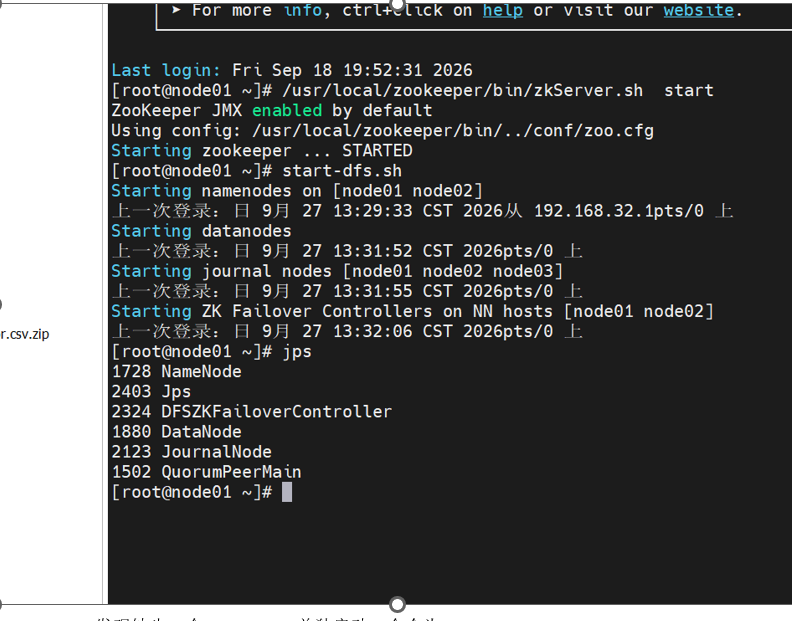
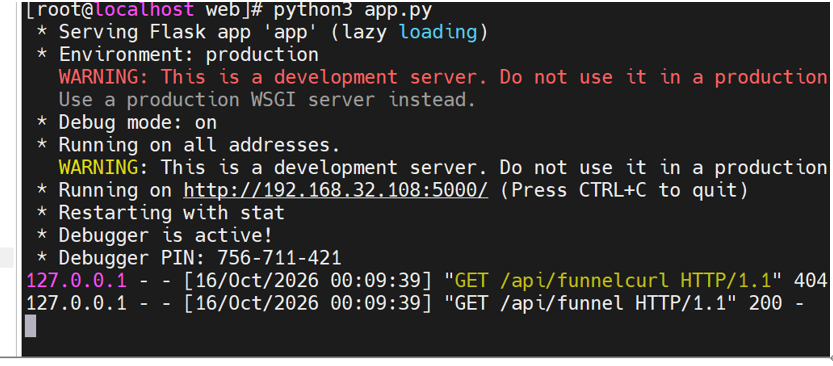

# 开发日志

本文档按时间线记录项目从立项到交付的完整开发过程。

---

## Day 1：环境搭建 + 数据下载 + 集群启动

**目标**：搭好基础环境，把数据准备好。

**完成事项：**
1. 启动 Zookeeper 集群（3 台）
2. 启动 HDFS HA（node01/node02 互为 NameNode）
3. 启动 YARN
4. 下载 UserBehavior.csv（约 3.4G）
5. 上传到 HDFS：`/origin_data/user_behavior/2026-09-27/UserBehavior.csv`

**遇到的问题：**
- 上传时发现不能直接传 zip 文件，Spark 读不了压缩包。删掉 zip，本地解压后重新上传。

**截图记录：**
- Zookeeper/HDFS/ 启动成功的 jps 输出
- HDFS 上文件大小 `3.4G`

---

## Day 2：数据探查（用 Spark Shell）

**目标**：搞清楚数据长什么样、干不干净。

**完成事项：**
1. 用 Spark Shell 读取 CSV
2. 重命名列：`user_id, item_id, category_id, behavior, timestamp`
3. 查看 Schema、总行数、行为分布
4. 检查空值、唯一值、时间范围
5. 按天统计行数
6. 检查完全重复行
7. 初步探查数据倾斜风险

**遇到的问题：**
- **时间戳类型陷阱**：`min/max` 显示 1929-2001，明显不对。原因是 Spark 默认把 CSV 全读成 String，`min/max` 走字典序。
- **异常时间戳**：发现负数（-1586903608）和超大正数（2122867355），占比 1.509%。

**解决过程：**
- 用 `CAST(AS BIGINT)` 显式转换
- 用 `filter(cast(LongType) < 0)` 和 `> 2000000000` 定位异常行
- 确定真实时间范围：`1511544070 ~ 1512312365`（2017-11-25 至 2017-12-03）

**产出：**
- `docs/01-数据探查报告.md`

---

## Day 3：数仓分层架构设计

**目标**：确定 ODS / DWD / DWS / ADS 四层模型。

**完成事项：**
1. 画分层架构图（数据流转图）
2. 设计每层的表结构
3. 确定分区策略：大表按天分区，小表不分区
4. 确定存储格式：ODS 用 TEXTFILE，其他层用 PARQUET

**思考记录：**
- ODS 不做清洗，原因：出问题可以追溯原始数据
- DWD 用 PARQUET，原因：列式存储、压缩率高、查询快
- DWS 分三张表（按天/商品/用户），原因：维度不同，合并会爆炸

**产出：**
- `docs/02-数仓设计文档.md`

---

## Day 4：ODS 层建表 + 数据映射

**目标**：在 Hive 中建 ODS 外部表，映射 HDFS 上的 CSV。

**完成事项：**
1. 在 Hive 中创建数据库 `user_behavior`
2. 创建外部表 `ods_user_behavior`
3. 验证数据：`SELECT COUNT(*) FROM ods_user_behavior;`
4. 查询结果：`100150807` 条，与预期一致

**遇到的问题：**
- `timestamp` 是 Hive 保留字，建表时必须用反引号

---

## Day 5：DWD 层 ETL（第一次尝试，失败）

**目标**：清洗、去重、类型转换，写入 DWD 层。

**完成事项：**
1. 创建 DWD 分区表 `dwd_user_behavior`
2. 写 ETL SQL：过滤异常时间戳 + ROW_NUMBER 去重 + 类型转换
3. 用 SparkSQL 执行

**遇到的问题：**
- **内存不足**：`spark-sql --master yarn` 卡在 7.5% 不动
- **磁盘爆满**：改用 Hive 跑全量后，DWD 层报 `No space left on device`

**当时的状态：**
- `df -h` 显示 `/dev/mapper/centos-root` 只剩 1.1G
- `hdfs dfsadmin -report` 显示 DFS Remaining 只剩 1.08G

**决策：**
先停下来，降级为伪分布式，新建伪分布式集群上传csv

---

## Day 6：DWD 层 ETL（第二次尝试，成功）

**目标**：解决磁盘爆满，让 DWD 跑通。

**完成事项：**
1. 清理临时文件：`/tmp/spark-*`、`/tmp/blockmgr-*`、`/tmp/hive*`
2. 清理 HDFS staging 目录
3. **关键决策**：去掉 `ROW_NUMBER()` 全量去重。因为完全重复行只有 49 条（占比 0.00005%），不值得全量 Shuffle
4. 改用 `WHERE` 过滤 + 直接清洗写入
5. 关闭 YARN，改用 `spark-sql --master local[2]`
6. 调小 shuffle 分区：`spark.sql.shuffle.partitions=8`
7. 开启 AQE：`spark.sql.adaptive.enabled=true`

**执行结果：**
- DWD 层耗时 429 秒
- 清洗后数据量：`98639243` 条（与探查结论一致）

**产出：**
- `docs/05-优化记录.md`（部分）
- `docs/06-问题与解决.md`（部分）

---

## Day 7：DWS 层建模

**目标**：按天、商品、用户三个维度做轻度汇总。

**完成事项：**
1. 创建 `dws_behavior_daily`（按天汇总），耗时 56 秒
2. 创建 `dws_item_daily`（按商品汇总），耗时 146 秒
3. 创建 `dws_user_daily`（按用户汇总），耗时 36 秒

**遇到的问题：**
- 商品维度有 416 万个商品，`GROUP BY item_id` 的分组数远大于按天（只有 10 个），所以耗时最长
- 日志里频繁出现 `RowBasedKeyValueBatch: Calling spill()` 警告，这是 Spark 在内存不足时尝试溢写磁盘的正常提示，不影响结果

**截图记录：**
- 三张 DWS 表的 `SELECT *` 结果截图

---

## Day 8：ADS 层建模

**目标**：计算漏斗、TopN、复购率三个业务指标。

**完成事项：**
1. 创建 `ads_funnel_daily`，耗时 2.36 秒
2. 创建 `ads_topn_item_daily`，耗时 5.45 秒
3. 创建 `ads_repurchase_rate`，耗时 5.55 秒

**遇到的问题：**
- **复购率首次算出 64.98%**，明显偏高
- 排查后发现问题：原始数据没有 `order_id`，用户在同一天点了两次购买按钮，就被算作"复购"
- **口径调整**：从"按购买次数 >= 2"改为"按购买天数 >= 2"
- 重新计算后：**53.68%**，更合理

**思考记录：**
- 由于数据集只有 9 天，且是双十二大促前夕，复购率整体偏高
- 面试时要主动解释这一点，展示对口径的思考

**产出：**
- `docs/03-指标口径说明.md`

---

## Day 9：写入 MySQL + 可视化

**目标**：把 ADS 结果推到 MySQL，并用 Flask + ECharts 展示。

**完成事项：**
1. MySQL 建库 `ecommerce_ads`，建三张结果表
2. Spark JDBC 写入 MySQL
3. 验证 MySQL 数据：`SELECT * FROM ads_funnel_daily;` 等
4. Flask 后端：写 3 个 API（`/api/funnel`、`/api/topn`、`/api/repurchase`）
5. ECharts 前端：做 4 个图（漏斗、折线、柱状、仪表盘）

**截图记录：**
- Flask 启动

---

## Day 10：调度脚本 + 项目文档

**目标**：收尾。

**完成事项：**
1. 写 `scripts/etl_daily.sh`：串联 DWD → DWS → ADS → MySQL
2. 调试脚本，处理磁盘爆满和 MySQL 找不到的问题
3. 写 6 份文档：`README.md` + `docs/01~06`
4. 整理截图，放进 `docs/images/`，在 README 中引用

**思考记录：**
- 脚本目前是全量跑，生产环境应改为按天增量 + 依赖调度
- 这个优化点写进 `05-优化记录.md`

---

## 总结：项目时间线

| 阶段 | 天数 | 关键产出 |
|---|---|---|
| 环境搭建 + 数据探查 | Day 1-2 | `01-数据探查报告.md` |
| 数仓设计 + ODS | Day 3-4 | `02-数仓设计文档.md` |
| DWD 层（失败 → 成功） | Day 5-6 | `06-问题与解决.md` |
| DWS 层 | Day 7 | 3 张 DWS 表 |
| ADS 层 | Day 8 | `03-指标口径说明.md` |
| 写入 MySQL + 可视化 | Day 9 | ECharts 大屏 |
| 调度 + 文档 | Day 10 | `README.md` + `05-优化记录.md` |

**核心收获：**
- 数据开发不是"写完 SQL 就结束"，**数据探查和口径设计占了一半的工作量**。
- 遇到瓶颈（内存、磁盘、YARN）不要硬刚，**分析根因 → 降级方案 → 验证效果**。
- 文档和代码一样重要，**能讲清楚的项目才是好项目**。