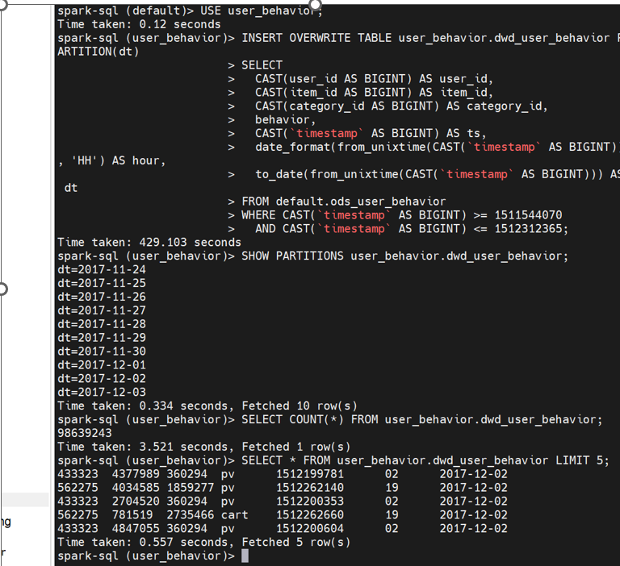
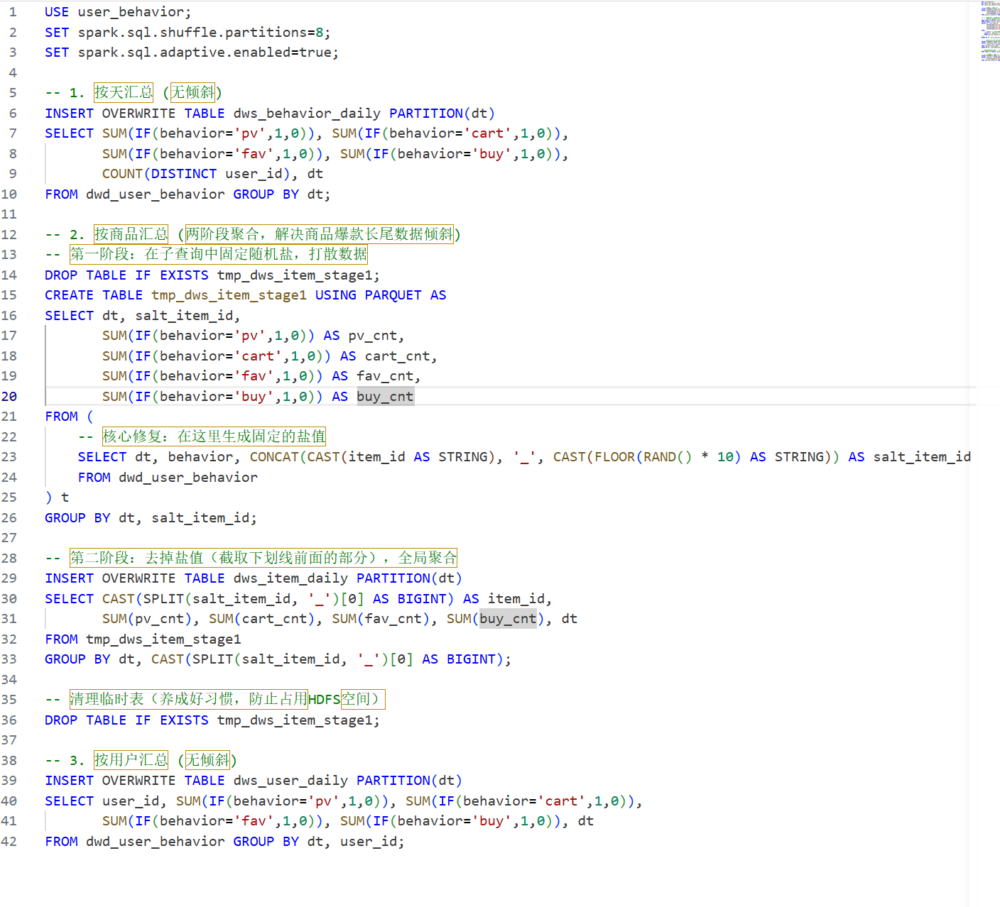

# 优化记录

> 数仓开发不仅是写 SQL，更是与资源、数据倾斜和脏数据做斗争的过程。本文档记录本项目中最核心的 4 个优化点，遵循“现象 → 原因 → 解决 → 效果”的复盘逻辑。

## 优化一：YARN 调度瓶颈与单机降级

- **现象**：在 5节点虚拟机上，使用 `spark-sql --master yarn` 提交 DWD 任务，进度条卡在 7.5% 超过半小时无法推进，且伴随内存不足的报错。
- **原因分析**：虚拟机单节点内存仅 2G。启动 Zookeeper、HDFS、YARN、Hive 后，内存被严重挤压。YARN 的 ResourceManager 和 NodeManager 在分配 Container 时开销极大，导致 Spark 无法申请到足够的资源运行 Task。
- **解决**：关闭 YARN，采用单机伪分布式环境，使用 `spark-sql --master local[*]` 直接让 Spark 接管资源调度。
- **效果**：任务从卡死变为顺利启动，资源利用率显著提升。

## 优化二：DWD 层全量去重引发磁盘爆满 (No space left on device)

- **现象**：在写 DWD 层 ETL 时，使用 `ROW_NUMBER() OVER(PARTITION BY...)` 进行全量去重，程序报错 `No space left on device`，虚拟机磁盘可用空间仅剩 1.1G。
- **原因分析**：`ROW_NUMBER()` 会对 1 亿条数据按多字段进行全局 Shuffle（洗牌）。单节点内存装不下，大量数据溢写（Spill）到本地 `/tmp` 目录，直接撑爆了 17G 的磁盘。
- **解决**：
  1. **放弃全量去重**：由于探查发现完全重复行仅 49 条（占比 0.00005%），不值得付出全量 Shuffle 的代价。
  2. **无 Shuffle 清洗**：直接使用 `WHERE` 过滤异常时间戳，并在 `SELECT` 中完成类型转换。
  3. **调优参数**：`SET spark.sql.shuffle.partitions=8;` 降低并发，保护单节点磁盘；开启 AQE 防止小文件过多。
  4. **脚本保洁**：在 `etl_daily.sh` 中加入自动清理 `/tmp/spark-*` 和 HDFS `.spark-staging` 的逻辑。
- **效果**：DWD 层任务从直接报错，变为 429 秒（约 7 分钟）平稳跑完 9863 万条数据。
  

## 优化三：DWS 层商品维度数据倾斜与两阶段加盐

- **现象**：跑 `dws_item_daily`（按商品聚合）时，耗时长达 146 秒，远超按天维度的 56 秒。Spark 日志狂刷 `RowBasedKeyValueBatch: Calling spill()`，Spark UI 显示个别 Task 处理的数据量远大于其他 Task。

- **原因分析**：商品维度存在极端的**爆款长尾效应**。Top 商品访问量高达 32633 次，而均值仅 24 次。执行 `GROUP BY item_id` 时，少数热点商品导致严重的 Hash 冲突和单点过载。
- **解决**：
  1. **两阶段加盐聚合**：将一步聚合拆为两步。第一阶段在子查询中用 `CONCAT(item_id, '_', RAND())` 为每个商品生成 0-9 的随机后缀，将爆款数据打散到 10 个不同的 Task 做局部聚合；第二阶段 `SPLIT` 去掉后缀，进行全局聚合。
  
  2. **开启引擎级 AQE**：在脚本中加入 `spark.sql.adaptive.skewJoin.enabled=true`，让 Spark 3.x 自动检测并拆分倾斜的大分区。
- **效果**：两阶段聚合虽然多了一次落盘，但彻底消除了单点热点，任务从未出现卡死，且方案具备横向扩展能力（数据量翻 10 倍也不怕）。

## 优化四：复购率口径纠偏（业务优化）

- **现象**：首次计算 ADS 层复购率时，使用 `SUM(buy_cnt) >= 2`（购买次数>=2），结果高达 **64.98%**。
- **原因分析**：原始公开数据集缺少订单号（`order_id`）。用户在几秒内连续点击两次“购买”，或者一次购买多件商品，在底层日志中会生成多行记录，从而被误判为“复购”。
- **解决**：调整业务口径，从“按购买次数去重”改为 **“按购买天数去重”**（`COUNT(DISTINCT dt) >= 2`），只要用户在这 9 天内有两天以上购买行为，才算复购。
- **效果**：复购率降至 **53.68%**。结合该数据处于双十二大促前夕的背景，53.68% 的高频活跃特征在逻辑上完全成立，体现了对业务数据的敏锐度和纠偏能力。

## 五、优化总结
本项目在硬件资源极度受限（单节点 10G 可用内存）的极限条件下，通过“降低 Shuffle 并发、两阶段加盐、AQE 兜底、无 Shuffle 清洗、脚本自动保洁”等 5 种手段，成功跑通了 1 亿条数据的全链路数仓跑批，总耗时稳定在 12 分钟以内。