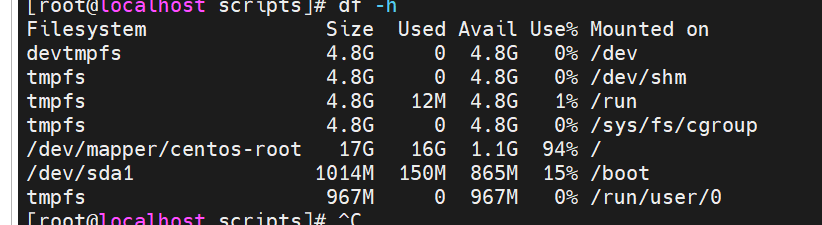

# 问题与解决记录（排错复盘 ）

> 本文档汇总了项目从集群搭建到自动化跑批全过程中遇到的核心故障及其排查过程
## 一、真实故障排查复盘（STAR 法则）

### 故障一：ZIP 文件直接读取报错与数据探查陷阱
- **现象**：最初将 `UserBehavior.csv.zip` 上传到 HDFS，使用 Spark 读取时报错 `PATH_NOT_FOUND`；后续解析时间戳时，发现了 1929 年、1902 年等荒谬日期。
- **原因分析**：Spark 无法直接读取压缩包内容；且 CSV 默认被当作 String 类型处理，`min/max` 走的是字典序而非数值大小。此外，数据中混入了 1.5% 的异常时间戳（负数或超大值）。
- **解决方案**：本地解压后重新上传 CSV；在 DWD 层通过 `CAST(AS BIGINT)` 强转，并通过限定时间窗口 `1511544070 ~ 1512312365` 精确过滤脏数据。
- **收获**：任何数仓建模的前提都是“数据探查”。必须先了解数据的脏乱差，才能在 DWD 层设计针对性的清洗规则。

### 故障二：YARN 调度卡死与单机环境降级
- **现象**：在 5 台各 2G 内存的虚拟机上跑 YARN，Spark 任务进度条卡在 7.5% 超过半小时无法推进，内存严重不足。
- **原因分析**：单节点内存太小，启动 Zookeeper、HDFS、YARN、Hive 后，YARN 分配 Container 的调度开销直接把资源吃光，Spark 无法拿到足够的资源运行 Task。
- **解决方案**：果断关闭 YARN，将架构降级为单机伪分布式，使用 `spark-sql --master local[*]` 直接调度，并清理了系统中无用的后台组件。
- **收获**：架构没有绝对的好坏，只有是否适配当前资源。在极限资源下，必须懂得做减法（降级）。

### 故障三：DWD 全量去重引发磁盘爆满 (No space left on device)
- **现象**：在 DWD 层使用 `ROW_NUMBER() OVER(PARTITION BY...)` 对 1 亿条数据进行全量去重时，报错 `No space left on device`。`df -h` 显示根目录仅剩 1.1G。
- **原因分析**：`ROW_NUMBER()` 会引发极其庞大的全局 Shuffle，单机内存扛不住，大量数据溢写（Spill）到 `/tmp` 目录，直接撑爆了 17G 的磁盘。
- **解决方案**：
  1. **代码层**：通过探查发现完全重复行仅 49 条（占比 0.00005%），直接放弃全量去重，改为在 `WHERE` 中过滤异常数据，用极小精度换取了极大性能。
  2. **参数层**：设置 `spark.sql.shuffle.partitions=8` 降低并发压力。
  3. **工程层**：在 Shell 脚本开头内置了清理 `/tmp` 和 HDFS `.spark-staging` 残留的逻辑。
- **收获**：千万级以上数据量，能不用窗口函数去重就绝不用，这是导致单机 OOM 和爆盘的最大元凶。

### 故障四：DWS 商品维度数据倾斜导致单点 Task 卡死
- **现象**：跑 `dws_item_daily`（商品维度聚合）时，耗时长达 146 秒，日志狂刷 `RowBasedKeyValueBatch: Calling spill()`。Spark UI 显示少数 Task 处理的数据量是其他 Task 的数十倍。
- **原因分析**：商品维度存在极端的**爆款长尾效应**。Top1 商品被访问了 3 万多次，而均值只有 24 次。`GROUP BY item_id` 导致少数热点商品把 Hash 槽位占满。
- **解决方案**：采用**两阶段加盐聚合**。第一阶段在子查询中用 `CONCAT(item_id, '_', RAND())` 为商品打上随机后缀，将爆款数据打散到 10 个不同的 Task 做局部聚合；第二阶段 `SPLIT` 去掉后缀，进行全局 `SUM`。
- **收获**：解决数据倾斜，最有效的手段是从业务维度（如 ID 打散）进行代码级改造，而不是单纯依赖调参。

### 故障五：调度脚本跑批失败的排错链路
- **现象**：编写好 `etl_daily.sh` 后跑批失败。
- **原因分析**：1. 提示 `File does not exist`，因为 SQL 没有放在对应的 `/root/sql` 目录；2. 提示 `could only be written to 0 of the 1 minReplication nodes`，因为磁盘满导致 DataNode 被 HDFS 客户端拒绝写入。
- **解决方案**：规范目录结构；在清理磁盘后，重启 DataNode。最终实现了脚本的一键全链路跑批（包含降级、防 OOM 参数、自动清理）。
- **收获**：脚本跑批和手动执行的最大区别在于“容错自愈能力”，生产环境的调度脚本必须在跑批前做环境保洁。

---